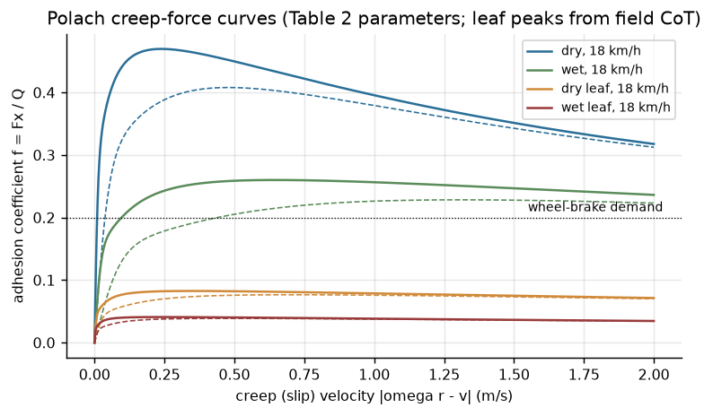
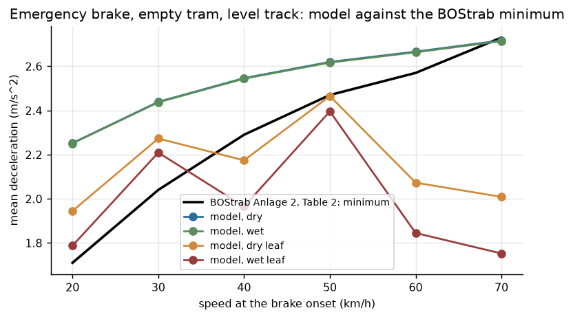
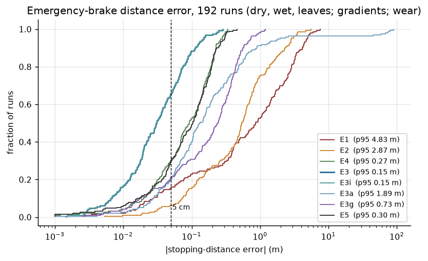
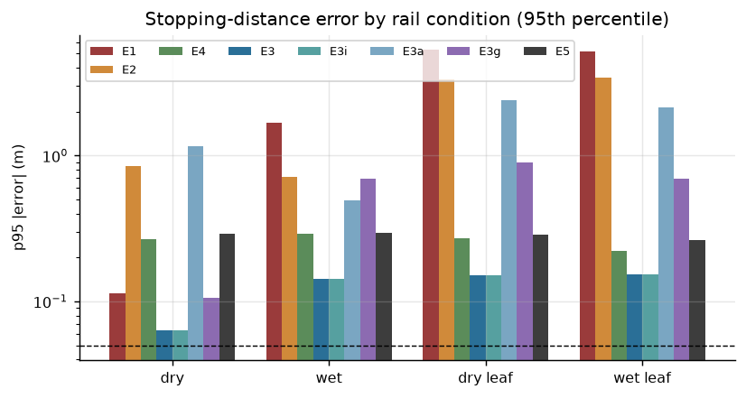
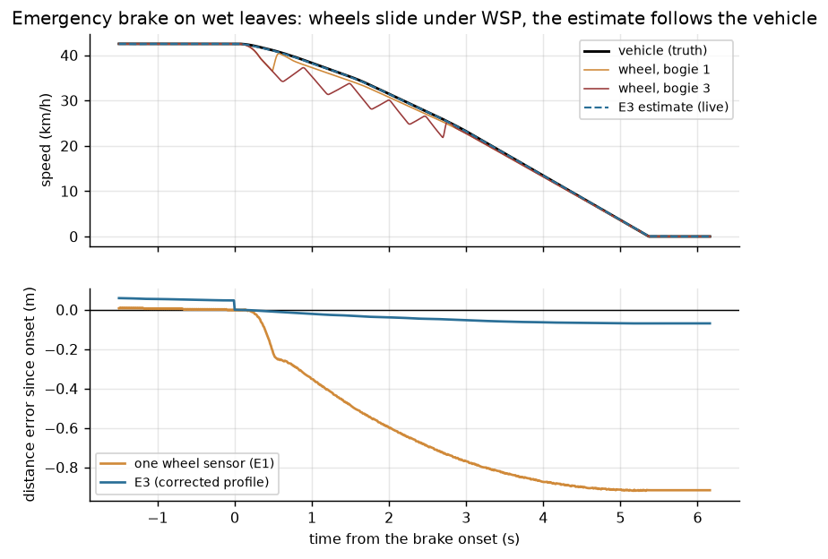
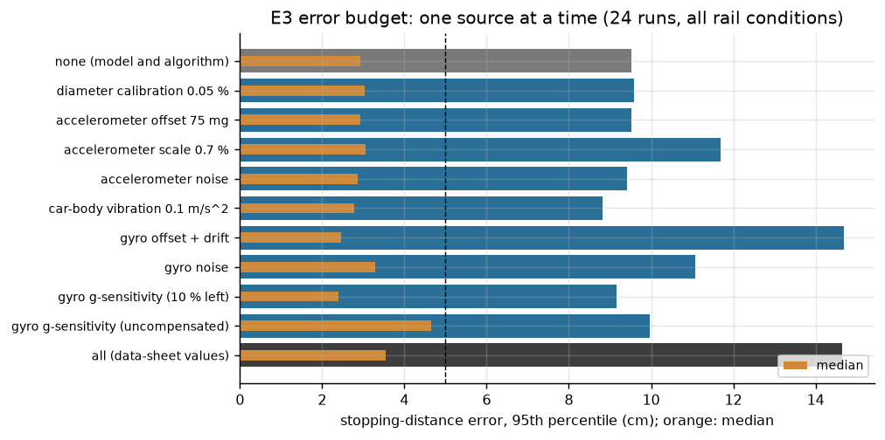
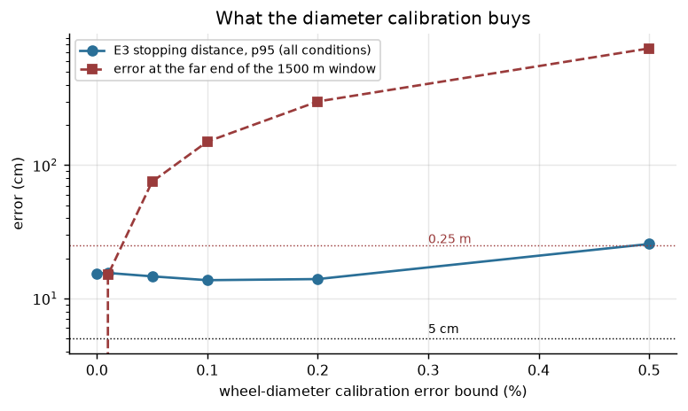
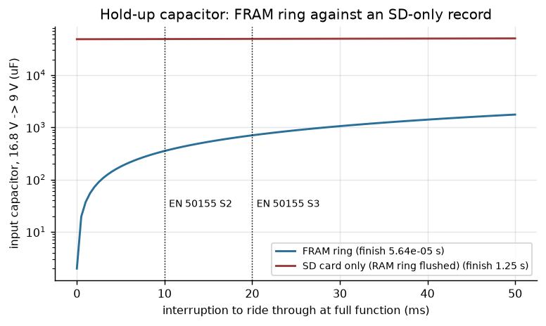
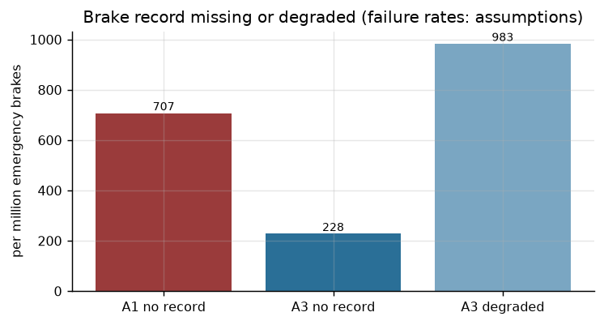

# Tram speed and event recorder under wheel slide: engineering dossier

Rev A, 11 Nov 2026. Portfolio and thesis-preparation work; not a product, not certified.

This dossier follows the systems-engineering spine of Wasson, *System Engineering Analysis, Design, and
Development*, 2nd ed. (Wiley, 2016) [W]. Each section names the chapter and pages it applies. Every
engineering number carries a reference key [Rn] (list in §17, details in [docs/sources.md](docs/sources.md))
and a status:
- **V**: read in the source. **V2**: read in a secondary source that quotes the primary.
- **D**: derived from V values by a stated method, or computed by the models of this repository.
- **A**: an assumption of this study (all listed in §14).

The models, firmware and tests that produce the results are in this repository. Study IDs (S1–S7) refer to
`model/studies/`, test IDs (ITxx) to `fw/tests/robot/odo.robot`, requirement IDs (OR-xx) to `fw/SRS.md`.

---

## 0. The question and the short answer

**Open engineering question.** A tram speed and event recorder is specified to keep the last 1500 m of
travel "with 0.25 m accuracy" and to measure the brake-test stopping distance "with 5 cm accuracy", and to
keep its record when the vehicle supply is cut [R19] (V). In an emergency brake on a wet or leaf-covered rail
the wheels slide, and on a modern low-floor tram every axle is braked, so no wheel rolls freely. **Can the
recorder still measure the stopping distance, and what sensor set, estimator and hold-up energy does it
take?**

**Short answer, from the models and firmware in this repository:**

1. **Wheel pulses alone cannot measure an emergency brake on a wet or leaf-covered rail** (S3, §9.3).
   - With one wheel sensor (today's recorder, E1) the stopping distance is under-read by a median of
     0.86 m and 4.8 m at the 95th percentile over 192 simulated brakes; on leaves the p95 is 5.2–5.3 m.
   - The cause is not only the slide. At the wheel-brake demand, the Polach creep alone is 0.19 % on a dry
     rail and 2.0 % on a wet one (S1), so even a wheel that does not slide reads 2 % short on a wet rail.
   - A second wheel sensor on another bogie (E2, larger increment) helps little: p95 2.9 m.
2. **Two wheel sensors plus a 6-axis MEMS IMU, with the wheels switched out for the whole brake, meet the
   brake requirement where it is defined** (E3, the chosen design).
   - Over the full envelope (dry, wet, dry and wet leaves; gradients to ±8 %; vertical curves; 38–52 t;
     30–70 km/h; wheel wear 630–680 mm): median error **3.0 cm**, p95 **14.7 cm**, worst 28.6 cm, i.e.
     0.3 % of the stopping distance at p95.
   - In the depot brake test (dry, level, empty, 30–50 km/h, calibrated wheels) the p95 is **2.5 cm** and
     every run is inside 5 cm (S4).
   - The distance comes from the accelerometer integral, started at the wheel speed before the brake and
     closed by the condition that the speed is zero at the detected standstill (two-point boundary
     correction, §8.3).
   - The **pitch gyro is necessary**. Without it (accelerometer only, E3a) the p95 is 1.9 m: on a vertical
     curve or under the body's pitch on its suspension, gravity along the car body changes during the
     brake, and the accelerometer cannot tell it from deceleration.
   - A **Doppler radar** (E4) gives p95 27 cm in the brake, but over 1500 m its ±0.5 % scale error [R10]
     makes 7.9 m (p95). Adding it to E3 (E5) does not help the brake (p95 30 cm).
3. **"0.25 m over the last 1500 m" can only be the sampling step, not an accuracy.**
   - 0.25 m in 1500 m is 0.017 %. A wheel diameter known to 0.05 % gives 0.75 m at the far end of the
     window; the best estimator here (E3) reaches 3.0 m p95 there, because traction creep and calibration
     act on the whole window (S3, S4). The firmware records one point every 0.25 m (OR-30) and reports the
     error budget instead of claiming a 0.25 m accuracy.
4. **The brake onset must be time-stamped, not sampled.** A 10 ms input sample is 19 cm at 70 km/h, four
   times the brake-test tolerance. The firmware integrates only the part of the onset tick after the captured
   edge (OR-20).
5. **Keep the record in FRAM, not in RAM flushed to an SD card** (S5, §7.4).
   - With every record written to FRAM when it is made, 353 µF on the 24 V input carry the unit through an
     EN 50155 class S2 interruption (10 ms) [R4] and finish the record; the power-fail record is in FRAM
     16 µs after the comparator edge (Renode, IT05).
   - Flushing a RAM ring of 1500 m (96 KB) to an SD card can take 1.25 s at the SD busy limit [R14]: that
     needs 0.53 F of supercapacitor.
6. **Architecture.** In the analysis of alternatives the two wheel sensors plus IMU (A3) score 7.94 against
   6.46 for the one-sensor recorder; A3 wins 70 % of 20 000 random weightings and no ±10 % change of a
   single weight changes the winner (S6, §8.1).

---

## 1. Problem space (W ch. 4, pp. 76–98)

**Problem statement** (one sentence, no solution words; W p. 92). After a tram collision or a brake test,
the operator and the investigator cannot trust the recorded distance and speed of the last metres when the
wheels were sliding.

**Discussion.**
- An urban tram must stop from 70 km/h within 69 m in an emergency brake (mean deceleration at least
  2.73 m/s²) on dry level track, and from 50 km/h within 39 m [R1 Table 2] (V). To get there it uses
  magnetic track brakes, which do not depend on adhesion, and wheel brakes, which do.
- Wheel-rail adhesion falls from about 0.25–0.45 on a dry rail to about 0.25 on a wet one [R2] and to
  0.04 on a wet leaf layer in field tests (dry leaf layers 0.06–0.11) [R3] (V). Under emergency braking on
  such a rail the wheel slide protection releases and re-applies each axle; the wheels turn slower than the
  vehicle moves.
- Recorders of driving data exist for accident investigation on all rail vehicle types [R7] (V2). A
  published tram recorder keeps the last 1500 m and measures the brake test from the wheel pulses, with the
  wheel diameter entered as a parameter [R19] (V).
- On a tram all axles are motored or braked (A). So the classic odometry trick of a free-rolling reference
  axle is not available.

**Need typing** (W Principle 4.12, p. 89).
- **Real need:** a stopping distance and a speed profile that hold up in an investigation, also when the
  wheels slid.
- **Projected need:** the same record as input to driver-assistance and collision-warning functions.
- **Perceived need:** "more resolution" (0.25 m, 5 cm). Resolution is not accuracy (§0 item 3).

**Stakeholders** (after W Table 4.2, pp. 84–85).

| Role | Description | Recorder concern |
|---|---|---|
| Driver (user) | operates the tram | the record must not blame the driver for the wheels' slide |
| Operator's depot (maintainer) | brake tests, wheel turning | 5 cm brake test; diameter entry after wheel turning |
| Accident investigator (end user) | reconstructs the last 1500 m | known error bounds; integrity after a supply cut |
| Vehicle integrator | supply, mounting, cabling | 24 V supply per EN 50155; two sensor cables; one box |
| Safety assessor | software and hardware evidence | EN 50716 / EN 50657 process [R5], EN 50126/50129 [R6] |
| Authority (BOStrab) | braking performance | Anlage 2 limits [R1] |

**Problem and solution spaces** (W Principles 4.17–4.18, Fig. 4.7, pp. 93–95). Problem 1.0 "know where the
tram was and how fast" splits into 1.1 sensing (wheel, inertial, ground speed), 1.2 estimation, 1.3
recording and integrity, 1.4 power, 1.5 calibration. The question of §0 is a **critical technical issue**
(W p. 100): the estimator, the sensor set and the hold-up energy must be chosen together.

## 2. Mission analysis, use cases and scenarios (W ch. 5, pp. 99–128)

**Mission statement** (one outcome, W Principle 5.2): every metre and every brake of the tram's service is
on record with a known error, and the record survives the end of the supply.

**Mission objectives.**
- **Performance:** stopping distance of an emergency brake to 5 cm in the depot brake test and to 0.30 m
  (p95) in service, including slide (§5).
- **Integrity:** no record lost or silently wrong after a supply cut.
- **Constraint:** one box in the cab, 24 V supply per EN 50155, sensors that a depot can maintain.

**Phases** (W Principle 5.7, p. 110): pre-mission (power-up, journal recovery, standstill calibration of the
IMU offsets at the first stop); mission (runs between stops, service and emergency brakes); post-mission
(record download, wheel turning and diameter calibration).

**Mission event timeline** (W Fig. 5.5, p. 112):

```
 t0 power on -> t1 BOOT record, journal recovered -> t2 first standstill: IMU offsets learnt
 -> t3 departure (traction creep) -> t4 cruise on gradients -> t5 emergency brake (slide, track brakes)
 -> t6 standstill: corrected BRAKE_RES record -> t7 supply cut: PFAIL record, last record in FRAM
```

**Use cases** (W Table 5.1, p. 123; Principle 5.23, pp. 122–125).

| UC | Actor | Normal outcome | Abnormal outcome (W Fig. 19.5) |
|---|---|---|---|
| UC1 emergency brake in service | driver, investigator | BRAKE_ON and BRAKE_RES records, distance within 0.30 m p95 | wheels slide: IMU carries the distance (E3) |
| UC2 depot brake test | maintainer | distance within 5 cm | uncalibrated diameter: CALBAD flag in every record |
| UC3 accident reconstruction | investigator | last 1500 m at 0.25 m spacing with flags | torn last record: recovery keeps all complete ones |
| UC4 wheel turning, calibration | maintainer | diameters from two marks 100 m apart | result outside 0.600–0.700 m rejected per axle |
| UC5 supply interruption | vehicle | full function through 10 ms (S2) | supply gone: PFAIL record, journal consistent |
| UC6 sensor failure | — | degraded mode, flagged | both wheel sensors failed: brake event stays open |

## 3. Concept of operations (W ch. 6, pp. 129–146)

- The recorder is a cab box. It takes two wheel pulse generators (one axle on bogie 1 and one on bogie 3,
  two channels, 90°), a 6-axis IMU on its own board, the emergency-brake demand and a calibration-mark input
  as binary inputs, and the power-fail comparator of its own supply (after W Table 6.4, p. 143).
- At every stop it learns the accelerometer and gyro offsets (the tram stands still: speed 0, specific force
  = offset, pitch rate 0).
- While moving it estimates speed from the wheels, checked against the IMU; a wheel that disagrees is
  gated out (slide, spin, sensor fault).
- When the emergency-brake demand rises it stops using the wheels, integrates the IMU from the speed it had
  at the captured edge, and at the standstill closes the integral with the condition v = 0.
- It writes a record every 0.25 m and at every event to FRAM; an SD card (not modelled) keeps the long-term
  archive, copied in the background.

## 4. Phases, modes and states (W ch. 7, pp. 147–173)

States (W Table 7.1 format, p. 158; transitions as in W Fig. 7.14, p. 171):

| State | Entry | Behaviour | Exit |
|---|---|---|---|
| INIT | power-up | journal recovery, configuration check | first sensor sample (OR-01) |
| STAND | every healthy wheel at rest | standstill updates of speed, offset and gyro offset (OR-13) | wheel moves |
| RUN | a wheel moves | wheel updates through the gate (OR-14), records every 0.25 m | rest; brake edge |
| BRAKE | brake-demand rising edge (OR-20) | no wheel updates; inertial distance (OR-21) | standstill confirmed (OR-22) |
| CAL | calibration command at standstill (OR-40) | counts at two mark edges | second mark (OR-41) |

Overlay conditions (flags in every record): PFAIL (supply lost, unit still running on the hold-up),
WHEEL0/WHEEL1 (sensor failed, OR-17), IMU (latched fault, wheels only, OR-50), SLIDE (a wheel gated out
while moving), CORR (brake result corrected), CALBAD (default diameter in use, OR-42).

Degraded modes: one wheel sensor failed → estimator on the other; IMU failed → wheel-only brake without
correction (OR-53); both wheel sensors failed → no standstill evidence, the brake event stays open and is
recorded as such (FMEA W2, §10).

## 5. Requirements (W ch. 19–22, pp. 397–464)

System requirements derived from the sources (statement form after W Principle 22.5, p. 449; each with a
verification method after W Table 20.1, pp. 417–418). The software requirements OR-xx in `fw/SRS.md`
derive from these.

| ID | Requirement | Source and derivation | Verification |
|---|---|---|---|
| SYS-1 | The recorder shall record speed, distance and status continuously from power-up, on a 24 V supply from 16.8 to 36 V | [R19] (V); EN 50155 0.7–1.25 Un continuous [R4] (V2) | inspection; IT01 |
| SYS-2 | The recorder shall record the last 1500 m at 0.25 m spacing, with a distance error over the window within the calibration budget (0.05 % of the distance + 0.5 m) | [R19] (V) for 1500 m / 0.25 m; the accuracy is reinterpreted (§0 item 3, D) | analysis S3, S4 |
| SYS-3 | The recorder shall measure the emergency-brake stopping distance to 5 cm in the depot brake test (dry, level) and to 0.30 m (95th percentile) in service including wheel slide | [R19] (V) for 5 cm; 0.30 m = 0.4–3 % of the BOStrab stopping distances 9–69 m [R1] (D) | S3, S4; IT02–IT04 |
| SYS-4 | Every record shall carry its status flags and an integrity check | purpose of a driving-data recorder [R7] (V2) | test OR-25, OR-31 |
| SYS-5 | The recorder shall keep full function through a 10 ms supply interruption and keep every complete record after a supply cut | EN 50155 class S2 [R4] (V2); [R19] (V) | S5; IT05, IT06 |
| SYS-6 | The recorder shall process a sample in less than 10 % of the sample period | margin (A) | IT08 |
| SYS-7 | The recorder shall detect a failed wheel sensor or IMU and continue in a flagged degraded mode | FMEA §10 (D) | tests OR-17, OR-50, OR-53 |
| SYS-8 | The recorder shall accept sensor samples and commands and report status over a checked serial frame | interface (A) | tests OR-60..62 |
| SYS-9 | The software shall be developed with requirements traceability, structural coverage and a coding standard | EN 50657 / EN 50716 [R5] (V2): SIL-dependent techniques | CI evidence §12 |

**Abnormal and emergency operations** (W Fig. 19.5 and Principle 19.22, pp. 408–411) are explicit
requirements (OR-17, OR-22 fallback, OR-33, OR-35, OR-50, OR-53), not left to the design.

**Requirement validation** (W Principle 20.1, p. 418, and 20.5, p. 424): SYS-3's 5 cm is kept only where it
is achievable and meaningful (the depot brake test); in service the 0.30 m p95 is derived from the stopping
distances and verified by the Monte Carlo. SYS-2 changes the source's wording on evidence (S4).

## 6. Architecture and interfaces (W ch. 26–27, pp. 542–598)

**Physical architecture** (W Fig. 26.9, pp. 562–564):

```
 bogie 1 axle 1 --[2-ch Hall, 100 teeth]--+
 bogie 3 axle 1 --[2-ch Hall, 100 teeth]--+--> QTMR/ENC quadrature capture --+
 IMU board (accelerometer + pitch gyro) ------ SPI --------------------------+--> i.MX RT1064 (Zephyr)
 brake-demand input, mark input --------- opto inputs, edge capture ----------+     lib/odo: estimator,
 24 V supply -> reverse diode -> 1000 uF hold-up -> DC/DC -> 3.3 V                  brake, journal
            \-> power-fail comparator ------------------------------------------>   GPIO interrupt
                                                    SPI FRAM 1 Mbit (record ring) <-+
                                                    SD card (archive, background)   <-+
                                                    vehicle bus / display (status)  <-+
```

**Interfaces** (keyed source–destination, W Figs. 27.4/27.5, p. 590; W Principle 27.6):

| ID | From → to | Content | Rate | Check |
|---|---|---|---|---|
| I1 | wheel sensors → capture | quadrature edges, 400 per revolution | up to 3.8 kHz at 70 km/h (D) | stuck-sensor check OR-17 |
| I2 | IMU → MCU | specific force (x), pitch rate (y) | 100 Hz, 50 Hz filter | range check OR-50 |
| I3 | brake demand → capture | rising edge, µs time | event | onset OR-20 |
| I4 | comparator → GPIO interrupt | supply below threshold | event | PFAIL OR-35 |
| I5 | MCU → FRAM | 16-byte records, CRC-16 | ≤ 4 per 10 ms | recovery OR-32/33 |
| I6 | MCU ↔ vehicle/rig | frames A5 5A len type payload CRC16 | 100 Hz in, 10 Hz out | OR-60..62 |

In the emulator I1–I3 are carried by the rig's sensor frame (the sampled front end): Renode's RT1064 model
has neither the quadrature decoder nor the IMU (§14).

## 7. Performance budgets and margins (W ch. 31, pp. 666–681)

### 7.1 Stopping-distance error budget (S4; method of W Fig. 31.1 and Example 31.3, pp. 669–671)

Each error source alone, at its data-sheet value, on the same 24 brakes of the full envelope (p95):

| Source | Value | p95 error | Note |
|---|---|---|---|
| model and algorithm alone (ideal sensors) | — | 9.5 cm | onset ramp, standstill detection, traction creep in v0 |
| wheel-diameter calibration | ±0.05 % (A) | 9.6 cm | enters through v0 only |
| accelerometer offset | ±75 mg [R9] | 9.5 cm | learnt at standstill and through the wheels |
| accelerometer scale | 0.1 % + 0.01 %/°C × 60 °C [R9] | 11.7 cm | the brake changes f by ~3 m/s² |
| accelerometer noise | 25 µg/√Hz [R9] | 9.4 cm | negligible |
| car-body vibration | 0.1 m/s² rms, 1–10 Hz (A) | 8.8 cm | band-limited: does not integrate into drift |
| gyro offset and drift | ±1 °/s, ±0.015 °/s/K × 2 K [R20] | 14.7 cm | the dominant sensor term (g δb T³/12) |
| gyro noise | 0.014 °/s/√Hz [R20] | 11.1 cm | |
| gyro g-sensitivity, 10 % left after calibration | 0.01 °/s/g (A on [R20]) | 9.2 cm | uncompensated (0.1 °/s/g): median doubles, 2.4 → 4.7 cm |
| **all together** | | **14.6 cm** | budget SYS-3: 30 cm p95, margin 2× |

The terms do not add: most of them are absorbed by the boundary correction. The residual is set by what
changes **during** the brake: the gyro offset error grows linearly in time and leaves g δb T³/12 after the
correction (§8.3).

### 7.2 Calibration and the 1500 m window (S4)

| Diameter error | Brake p95 (all conditions) | Error at the far end of 1500 m |
|---|---|---|
| 0.01 % | 15.5 cm | 0.15 m |
| 0.05 % | 14.6 cm | 0.75 m |
| 0.1 % | 13.7 cm | 1.5 m |
| 0.2 % | 14.0 cm | 3.0 m |
| 0.5 % | 25.6 cm | 7.5 m |

The brake distance is insensitive to the diameter (the wheels only give v0); the 1500 m window is
proportional to it. The calibration over two marks 100 m apart at 1 m/s resolves 1 cm in 100 m (0.01 %,
OR-41); IT07 measured the two diameters to −18 µm and +4 µm (0.003 %). Wear between calibrations
(680 → 630 mm over the wheel life [R11]) is the reason to recalibrate after every wheel turning and at a
fixed mileage (A).

### 7.3 Timing budget

| Item | Budget | Measured |
|---|---|---|
| one sample (wheel update, filter, brake, records) | 1 ms (10 % of 10 ms, SYS-6) | 63 µs worst case (IT08, Renode virtual time) |
| power-fail record after the comparator edge | before the hold-up is exhausted (≥ 10 ms) | 16 µs (IT05) |
| brake onset resolution | 5 cm / 19.4 m/s = 2.6 ms (D) | captured edge, µs (OR-20) |

### 7.4 Memory and hold-up energy (S5)

- Ring: 1500 m / 0.25 m = 6000 records × 16 B = 96 KB; 8192 slots = 128 KB = one 1-Mbit FRAM (D).
- Energy: E = P t_ride + P_finish t_finish; capacitor C = 2E / (η (u1² − u2²)) from 16.8 V (0.7 Un [R4])
  down to 9 V (DC/DC minimum, A), η = 0.85, P = 3 W (A).

| Storage | Time to finish the record | Capacitor for S2 (10 ms) | for S3 (20 ms) |
|---|---|---|---|
| FRAM ring (record written when made) | 56 µs | **353 µF** input side | 704 µF |
| SD only (RAM ring flushed, 3 × 32 KB + 2 file-system writes at the 250 ms busy limit [R14]) | 1.25 s | 49 000 µF, or **0.53 F** supercapacitor | 0.53 F |

Decision: FRAM ring, 1000 µF/50 V on the input (2.8× margin for ageing and tolerance). The SD card stays as
an archive that may lose its last seconds.

## 8. Analysis of alternatives (W ch. 32, pp. 682–702)

### 8.1 Sensor set (S6)

Alternatives: A1 one wheel sensor (today's recorder); A2 two wheel sensors; A3 two wheel sensors + IMU;
A4 wheel sensor + Doppler radar; A5 two wheel sensors + IMU + radar. Criteria and weights (W Table 32.1,
p. 691); the accuracy scores come from S3 (10 at the target, −3 per decade above it); the others are
assumptions with the reason below.

| Criterion | Weight | A1 | A2 | A3 | A4 | A5 |
|---|---|---|---|---|---|---|
| brake distance under slide (p95, target 5 cm) | 0.30 | 4.04 | 4.73 | **8.60** | 7.79 | 7.66 |
| last-1500 m distance (p95, target 0.25 m) | 0.15 | 5.99 | 4.23 | 6.75 | 5.51 | 6.84 |
| unit cost | 0.15 | 10 | 9 | 8 | 4 | 3 |
| installation and upkeep | 0.15 | 10 | 9 | 9 | 4 | 4 |
| availability (degraded modes) | 0.15 | 3 | 6 | 8 | 6 | 9 |
| software assurance effort | 0.10 | 9 | 8 | 6 | 7 | 4 |
| **weighted total** | | 6.46 | 6.45 | **7.94** | 5.96 | 6.12 |

Reasons for the assumed scores: a MEMS IMU costs a few euros and sits on the recorder board (no extra
cabling); a ground radar under a street-running low-floor tram needs a mounting under the car body, cleaning
and an aiming calibration [R10 notes the aiming error]; A1 has no second source when its sensor fails; the
estimator in A3/A5 is more software to assure.

**Robustness** (W p. 692 and Fig. 32.4): A3 wins 70.1 % of 20 000 Dirichlet-random weightings (A1 28.8 %,
when cost and upkeep get most of the weight); no ±10 % change of any single weight changes the winner.

### 8.2 Storage: FRAM ring against SD only — §7.4 (D7 in §15).

### 8.3 The brake estimator (S3, S4)

| Option | What it does in the brake | p95 all conditions | Why it is (not) chosen |
|---|---|---|---|
| E3 (chosen) | no wheel updates; IMU integral from v0; boundary correction v(T) = 0; pitch gyro for gravity | **14.7 cm** | best in every condition |
| E3h | as E3, but the wheel distance when no slide is seen | worse: the braking creep (2 % wet) is not a slide (S3) | rejected (D3) |
| E3g | wheels used whenever the gate accepts them | 73 cm | small slides inside the gate add up |
| E3a | E3 without the gyro | 1.9 m | gravity changes on vertical curves and under body pitch |
| E5 | E3 + radar updates | 30 cm | the radar's ±0.5 % scale replaces the boundary information |

**Why the boundary correction works.** During the brake the inertial speed is
v(t) = v0 + ∫(f − ĉ) dt. An offset error δc that stays constant over the brake leaves a speed residual
r = δc T at the standstill, where the true speed is 0. Removing that offset gives
d = D(T) − r T / 2 exactly (OR-23). An offset error that grows linearly (gyro offset error δb: δc = g δb t)
leaves −g δb T³/12; that is why the gyro offset is learnt at every stop and tracked between stops.

## 9. Modelling and simulation (W ch. 33, pp. 703–720)

### 9.1 M&S plan (W p. 707)

| Model | Purpose | Fidelity | Validation |
|---|---|---|---|
| Polach creep force [R2] with Hertz contact | wheel-rail force vs creep | Table 2 parameters; leaf peaks scaled to [R3] | test_physics: Table 2 values, leaf peaks, analytic slope |
| tram brake dynamics: 6 axles, implicit wheel solver, WSP, track brakes, gradients, vertical curves, body pitch (1.5 Hz) | wheel speeds and true motion | 2 ms steps in the brake | S1 against BOStrab Table 2 |
| sensor models: quadrature edges with capture times; ADXL355-class accelerometer [R9]; BMI088-class gyro [R20]; radar ±0.5 % [R10]; vibration 1–10 Hz | what the recorder sees | data-sheet errors drawn per run | — |
| estimators E1–E5 (`model/odo/estimator.py`) | candidates | double precision | synthetic runs with known answers (test_estimator) |
| firmware `fw/lib/odo` | the product | float32 | equals the Python E3 within 2 mm on four recorded scenarios (OR-80) |

Monte Carlo envelope (S3): 4 rail conditions × 48 runs; speed 30–70 km/h; brake after 1550–1650 m from a
5 s standstill; gradient ±8 % (±5 % with leaves, sanding not modelled); a vertical curve of up to ±4 %
change over 40–120 m around the brake; mass 38–52 t; wheel diameters 635–680 mm per bogie; sensor errors
drawn from the data-sheet ranges.

### 9.2 Results: braking physics (S1)



- Peak adhesion at 36 km/h: dry 0.44, wet 0.25, dry leaves 0.08, wet leaves 0.04 (the last two set to [R3]).
- Creep needed for the wheel-brake share (f = 0.2): **0.19 % dry, 2.0 % wet**: the wheels under-read by this
  much without any slide.
- Empty tram, level track: dry and wet meet BOStrab Table 2 from 20 to 60 km/h (e.g. 2.62 m/s² against
  2.47 at 50 km/h) and are 0.4 % short at 70 km/h (2.72 against 2.73) because of the jerk-limited build-up
  of the wheel brakes (A). With leaves the mean deceleration falls to 1.75 m/s² at 70 km/h (108 m against
  69 m), as expected without sanding.



### 9.3 Results: estimators over the envelope (S3)



| Estimator | p50 | p95 | worst | inside 5 cm | 1500 m window p95 |
|---|---|---|---|---|---|
| E1 one wheel sensor | 0.86 m | 4.83 m | 7.56 m | 16 % | 5.4 m |
| E2 two wheel sensors (larger increment) | 0.54 m | 2.87 m | 5.58 m | 6 % | 21 m |
| E4 Doppler radar | 9.2 cm | 27 cm | 34 cm | 30 % | 7.9 m |
| **E3 wheels + IMU (chosen)** | **3.0 cm** | **14.7 cm** | **28.6 cm** | **66 %** | **3.0 m** |
| E3a without the gyro | 13 cm | 1.89 m | 89 m | 20 % | 3.9 m |
| E3g wheels used when gated in | 24 cm | 73 cm | 1.19 m | 21 % | 3.0 m |
| E5 E3 + radar | 10 cm | 30 cm | 47 cm | 30 % | 2.8 m |

By rail condition (p95): E1 0.11 m dry, 1.69 m wet, 5.3 m dry leaves, 5.2 m wet leaves; E3 6.4 cm dry,
14.3 cm wet, 15.1 cm dry leaves, 15.3 cm wet leaves.



One emergency brake on wet leaves (WSP cycling, both bogies sliding): the one-sensor distance drifts to
−2.9 m, the E3 corrected profile stays within 0.1 m.



### 9.4 Results: error budget and calibration (S4)




Depot brake test (dry, level, empty, 30–50 km/h, stopping distances 14–37 m):

| Diameter calibration | E3 p95 | E3 inside 5 cm | E1 p95 | E1 inside 5 cm |
|---|---|---|---|---|
| 0.01 % | 2.5 cm | 100 % | 3.0 cm | 100 % |
| 0.05 % | 2.5 cm | 100 % | 3.5 cm | 100 % |
| 0.1 % | 3.0 cm | 100 % | 4.5 cm | 100 % |

On a dry level track the one-sensor recorder also meets 5 cm if its diameter is right; what it cannot do is
any brake with slide or wet-rail creep.

### 9.5 Results: hold-up (S5)



## 10. Reliability, maintainability, availability (W ch. 34, pp. 721–791)

**FMEA** (after W Fig. 34.20, p. 766; detection is part of the design, W Principle 34.28, p. 760):

| Row | Item / failure mode | Local effect | System effect | Detection | Mitigation |
|---|---|---|---|---|---|
| W1 | one wheel sensor dead or cable cut | no edges | estimator on the other wheel | OR-17: rest while the other wheel and the IMU move > 1 m/s for 2 s | flag WHEEL0/1; repair at depot |
| W2 | both wheel sensors dead | no standstill evidence | brake event stays open | OR-17 on the first, then no edges at all | flagged; no wrong result is written |
| W3 | wheel slide / spin | wheel speed wrong | none (gated out) | gate OR-14 | by design |
| I1 | IMU stuck at full scale | prediction wrong | wheel-only, no slide correction | OR-50 range check | flag IMU; OR-53 |
| I2 | IMU offset drift | slow error | learnt at every stop | standstill updates OR-13 | daily standstill check |
| F1 | FRAM write cut by the supply loss | one torn slot | none | CRC at recovery | OR-33 |
| F2 | FRAM device failure | records lost | no record | boot recovery finds no valid slot | watchdog/BIT (A) |
| P1 | power-fail comparator dead | no PFAIL record | last record may be torn | monthly interruption test (A) | OR-33 keeps all complete records |
| C1 | wrong diameter entered | scale error | 1500 m window wrong; brake insensitive | limits OR-41; CALBAD flag OR-42 | calibration run |
| B1 | brake-demand input open | no event | brake not recorded as an event | every depot brake test exercises it | test procedure |

**Quantitative estimate** (S7; failure rates are assumptions in the range of field data: wheel sensor
20 000 FIT, board 3000 FIT, IMU 500 FIT, power-fail circuit 400 FIT, FRAM 50 FIT; time in service until
repaired 24 h when detected on-line, plus half the test interval when latent):



- Probability that an emergency brake has **no record at all**: 707 per million brakes for A1 (its single
  wheel sensor is a single point of failure) against 228 per million for A3.
- A3 brakes recorded in a **degraded** mode (IMU down, or one wheel sensor down): 983 per million.
- A1's real weakness is not the missing record but the **wrong** one: every brake with slide or wet-rail
  creep (about 40 % of the S3 mix) is under-read by metres.

## 11. Qualification plan

- **EN 50155 [R4]:** supply range 0.7–1.25 Un and 0.6–1.4 Un for 100 ms; interruption class S2 (hold-up
  per §7.4); temperature class for the cab (−25..+85 °C [R19]); vibration and shock to EN 61373 (not read).
- **EMC:** EN 50121-3-2 (not read). The power-fail comparator needs a filter that ignores bursts but reacts
  within the 10 ms hold-up.
- **Recorder function:** brake tests on a measured track with a reference (optical correlation sensor or
  GNSS-RTK), dry and with artificial low adhesion (H1 in OPEN_ITEMS.md).

## 12. Software assurance: EN 50716 / EN 50657-style plans and evidence

EN 50657 governs on-board rolling-stock software; it was derived from EN 50128 and its SIL1–SIL4
requirements are equivalent to EN 50128:2011; EN 50716:2023 now replaces both [R5] (V2). The SIL of a
recorder function comes from the operator's hazard analysis (EN 50126 [R6]); a recorder is usually
SIL 0–2 (A). The repository applies the techniques of the higher SILs as a developer would:

| Technique | Evidence |
|---|---|
| software requirements with IDs and rationale | `fw/SRS.md` (33 requirements) |
| traceability requirement → test, checked | `fw/tools/trace.py` in CI: 33/33 |
| coding standard | MISRA C:2012 via cppcheck: no findings outside one advisory deviation (`fw/docs/misra.md`) |
| structural coverage | host tests: 100 % statements (596), branches (350), MC/DC condition outcomes (348), GCC 14 |
| functional tests on the target code | Renode IT01–IT08 on the RT1064 image |
| independent reference | the Python estimator (double precision) against the firmware (float32): within 2 mm |
| defensive programming | no dynamic memory, bounded loops, CRC on frames and records, plausibility checks |

Not done (needs an organisation): independence of verification, tool qualification, assessment (H8).

## 13. Verification and validation (W ch. 13, pp. 270–292; ch. 28, pp. 599–622)

### 13.1 Strategy (W Principles 13.3/13.4, p. 275; 13.11, p. 283)

Verification by analysis (S1–S7), by test on the host (unit tests, recorded scenarios), and by test on the
emulated target (Renode). Validation: the brake requirement is validated against the BOStrab stopping
distances (§5) and the dynamic model against BOStrab Table 2 (S1).

### 13.2 Integration (W Figs. 28.2/28.4)

Models → recorded scenarios (`tools/export_scenarios.py`) → firmware library on the host (same scenarios)
→ firmware image on the emulated RT1064 with the rig (same scenarios, plus power, calibration and frame
tests).

### 13.3 Evidence produced in this repository

| Check | Result |
|---|---|
| Model tests (`model/tests`) | 11 tests: source values, analytic derivatives, synthetic runs with known answers |
| Host unit tests (`fw/scripts/test-host.sh`) | 471 checks; 100 % lines, branches and MC/DC |
| Recorded scenarios on the host (OR-80) | depot dry +8 mm; wet 6 % downhill −78 mm; wet-leaf slide +64 mm; sag curve −130 mm (one wheel sensor: −11 mm, −1.05 m, −5.15 m, −3.10 m) |
| MISRA C:2012 | no findings outside D1 |
| Traceability | 33/33 |
| Renode IT01–IT08 | see README "Firmware evidence" |

### 13.4 Validation

The values that decide the answer (slide, creep, vibration, pitch) are model inputs; OPEN_ITEMS.md lists the
vehicle and laboratory measurements that would validate them.

## 14. What is sourced, what is assumed, and the limits

- **Sourced (V):** BOStrab limits [R1], Polach parameters [R2], leaf adhesion [R3], ADXL355 [R9], BMI088
  [R20], radar accuracy [R10], the recorder specification [R19]. **Secondary (V2):** EN 50155 classes [R4],
  EN 50657/50716 relation [R5], IEC 62625-1 scope [R7], wheel range [R11], gradients [R13], SD busy [R14].
- **Assumed (A):** the tram (mass, axles, track brakes, wheel-brake demand, WSP thresholds), the leaf patch
  layout, body pitch and vibration, the gyro g-sensitivity calibration, power and converter, failure rates.
  The assumptions table is in `docs/sources.md`.
- **Model limits.** The wheel-rail model is Polach's empirical curve, not a contact-mechanics solution with
  third-body layers; sanding is not modelled; the track brakes have a constant force; the vehicle is one
  rigid mass with pitch as a filtered response.
- **Emulator limits.** Renode's RT1064 has no quadrature decoder and no IMU: the rig sends the sampled front
  end as frames (I1–I3). The FRAM is an array in RAM. Cycle counts are Renode's virtual time.
- **Not certified.** The process is EN 50716/EN 50657 *style* only.

## 15. Decision log

| ID | Decision | Evidence |
|---|---|---|
| D1 | Brake distance from the IMU with a two-point boundary correction, not from the wheels | S3: E3 p95 14.7 cm against E1 4.83 m |
| D2 | A pitch gyro is part of the sensor set | S3: E3a (no gyro) p95 1.89 m; vertical curves and body pitch change gravity along the car |
| D3 | No wheel distance in the brake, also without a seen slide (E3h rejected) | S1: braking creep 2 % wet; E3h worse in every condition |
| D4 | A wheel at rest gives no speed measurement; standstill updates only while \|f − c\| < 0.15 m/s² | found by the models: at departure the first edges come late and pulled the filter to 0 |
| D5 | The brake-demand edge is captured with its time | 10 ms = 19 cm at 70 km/h; IT02 inside 5 cm |
| D6 | Standstill = end of the deceleration, confirmed by wheel rest and the inertial speed | locked wheels on leaves stop turning before the tram stops |
| D7 | FRAM record ring; SD only as an archive | S5: 353 µF against 0.53 F |
| D8 | Calibration over two marks 100 m apart at walking pace | mark sampled every 10 ms; IT07 0.003 % |
| D9 | "0.25 m over 1500 m" is implemented as the recording step; the accuracy is the budget of §7.2 | S3, S4 |
| D10 | IMU fault: the wheels carry the brake without correction | OR-53; the filter cannot follow a brake without the IMU |

## 16. Open engineering questions, and why they matter to a recorder maker

1. Measured creep and slide of a low-floor tram on wet rail and leaves, with a reference speed (H1): the
   whole case rests on the creep and slide levels.
2. The longitudinal vibration and pitch spectrum at the cab mounting (H2): the vibration term of the budget.
3. Can the gyro offset be learnt during cruise well enough to drop the dependence on recent stops? (The
   filter already tracks it; a long run without a stop is the open case.)
4. Can a wheel-turning record from the depot system update the diameter automatically and close the 1500 m
   window budget?

## 17. References

**Wasson**

[W] C. S. Wasson, *System Engineering Analysis, Design, and Development: Concepts, Principles, and
Practices*, 2nd ed. Hoboken, NJ: Wiley, 2016. Chapters 4–7, 13, 19–22, 26–28 and 31–34; pages in the text.

**Braking, adhesion and vehicles**

[R1] Verordnung über den Bau und Betrieb der Straßenbahnen (BOStrab), Anlage 2, Tables 1 and 2.

[R2] O. Polach, "Creep forces in simulations of traction vehicles running on adhesion limit," *Wear*
258 (2005) 992–1000.

[R3] J. Jaffé, K. Tomlinson, R. Lewis, "Moisture: the most important factor in leaf low adhesion?,"
*Tribology – Materials, Surfaces & Interfaces* 20(3) (2026) 189–205.

[R8] EN 15595, *Railway applications – Braking – Wheel slide protection* (concept only, not read).

[R11] UIC leaflet 510-2 (wheel diameters; via a search excerpt).

[R13] Published tram gradients (secondary sources; see docs/sources.md).

**Standards for rolling-stock electronics and software**

[R4] EN 50155:2021, *Railway applications – Rolling stock – Electronic equipment* (classes via supplier summaries).

[R5] EN 50657:2017+A1:2023 and EN 50716:2023 (relation to EN 50128 via standards-body abstracts).

[R6] EN 50126-1/-2, EN 50129 (background).

[R7] IEC 62625-1:2013, *On board driving data recording system – Part 1: System specification* (abstract).

**Sensors and storage**

[R9] Analog Devices, ADXL354/ADXL355 data sheet, Rev. A.

[R10] L. Du et al., "Speed calibration and traceability for train-borne 24 GHz continuous-wave Doppler
radar sensor," *Sensors* 20(4) (2020) 1230.

[R12] Two-channel Hall speed sensors for rail traction (60–300 pulses/rev; secondary).

[R14] SD card write busy limit 250 ms (SD Physical Layer specification, via driver commits).

[R20] Bosch Sensortec, BMI088 data sheet, rev. 1.9.

**Product reference**

[R19] A published tram speed/event recorder specification (name withheld under the repository naming rule).

---

**Revision history**

| Rev | Date | Change |
|---|---|---|
| A | 11 Nov 2026 | First issue |
