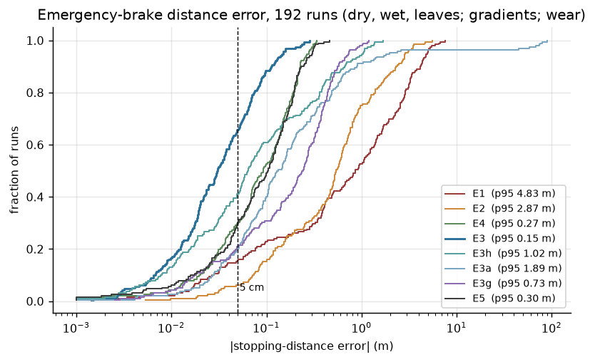
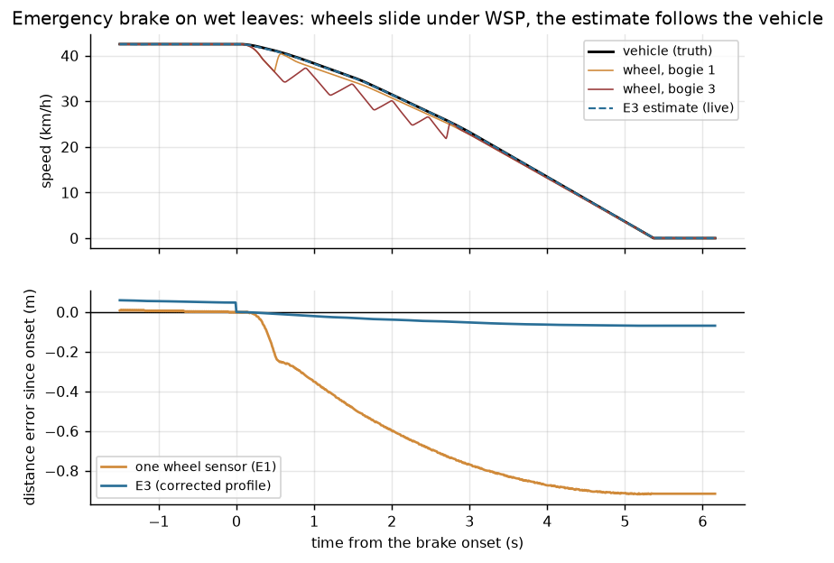
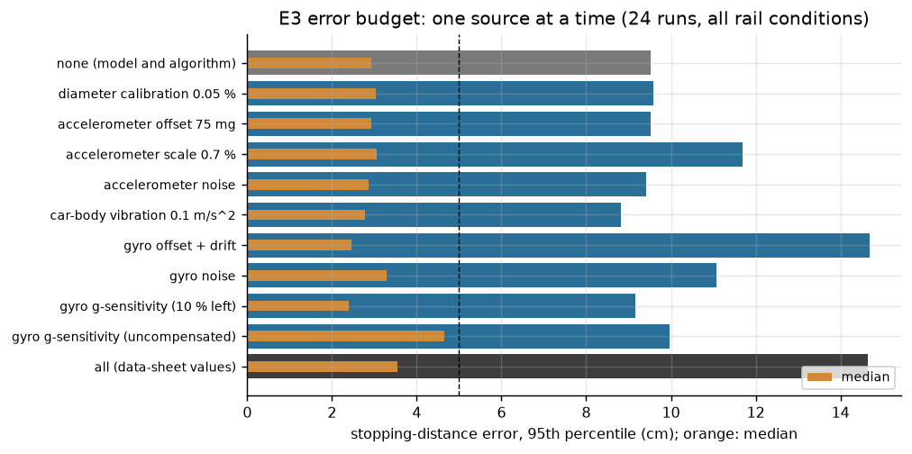

# Tram speed and event recorder under wheel slide

[](https://github.com/chad416/tram-odometry-wheel-slide/actions/workflows/ci.yml)

This repository studies one engineering question.

**The question:** a tram speed and event recorder keeps the last 1500 m of travel at 0.25 m and measures
the brake-test stopping distance to 5 cm. In an emergency brake on a wet or leaf-covered rail the wheels
slide, and on a low-floor tram every axle is braked, so no wheel rolls freely. Can the recorder still
measure the stopping distance, and which sensor set, estimator and hold-up energy does it take?

**What it contains:**
- **[DOSSIER.md](DOSSIER.md)** ([PDF](DOSSIER.pdf)): the engineering dossier on Wasson's systems-engineering
  spine:
  - problem, mission and use cases; concept of operations; modes and states;
  - requirements derived from BOStrab Anlage 2, EN 50155, EN 50657/EN 50716 and a published recorder
    specification;
  - architecture and interfaces; budgets (error, timing, memory, hold-up energy);
  - analysis of alternatives with robustness; modelling and simulation; FMEA and reliability;
  - verification and validation; decision log; limits.
- **`model/`**: Python models that answer the question:
  - Polach wheel-rail creep with Hertz contact; a 6-axle tram with wheel slide protection, magnetic track
    brakes, gradients, vertical curves and body pitch;
  - sensor models (quadrature wheel pulses with capture times, MEMS accelerometer and gyro from their data
    sheets, Doppler radar);
  - estimators E1–E5, a 192-run Monte Carlo, an error budget, hold-up energy, AoA, reliability.
- **`fw/`**: recorder firmware in C99 for an NXP i.MX RT1064 on Zephyr:
  - M/T wheel speed, a 3-state Kalman filter (speed, accelerometer offset, gyro offset), slide gate, brake
    measurement with a two-point boundary correction, power-fail-safe FRAM record ring, calibration;
  - tested on the host with 100 % MC/DC coverage and on recorded scenarios from the models;
  - tested in the Renode emulator.

It is a portfolio and thesis-preparation project, not a product, and not certified.



## Findings

| Question | Answer | Evidence |
|---|---|---|
| Can wheel pulses measure an emergency brake? | Not on a wet or leaf-covered rail. One wheel sensor under-reads the stopping distance by 0.86 m (median) and **4.83 m (p95)** over 192 brakes; on leaves 5.2–5.3 m p95. A second sensor on another bogie: 2.87 m p95. | S3, DOSSIER §9.3 |
| Is it only the slide? | No. At the wheel-brake demand the Polach creep is **0.19 % on a dry and 2.0 % on a wet rail**: a wheel that does not slide still reads 2 % short. | S1, DOSSIER §9.2 |
| What works? | Two wheel sensors + a 6-axis MEMS IMU, wheels switched out for the whole brake, the IMU integral closed by v = 0 at the standstill: **median 3.0 cm, p95 14.7 cm, worst 28.6 cm** (0.3 % of the distance at p95). | S3 (E3) |
| Is the gyro needed? | Yes. Without it (accelerometer only) the p95 is **1.89 m**: on vertical curves and under body pitch, gravity along the car changes during the brake. | S3 (E3a) |
| And a Doppler radar? | In the brake 27 cm p95, but its ±0.5 % scale makes **7.9 m** over the 1500 m window; added to the IMU design it does not help (30 cm). | S3 (E4, E5) |
| Is 5 cm reachable? | In the depot brake test (dry, level, calibrated): **p95 2.5 cm, 100 % of runs inside 5 cm**. Over the whole envelope 66 % of brakes are inside 5 cm. | S4, DOSSIER §9.4 |
| What limits it? | The gyro offset error, which grows linearly through the brake and leaves g δb T³/12 after the correction: 14.7 cm p95 alone; all sources together 14.6 cm. | S4, DOSSIER §7.1 |
| "0.25 m over 1500 m"? | Only as the recording step. 0.25 m in 1500 m is 0.017 %; a diameter known to 0.05 % already gives 0.75 m. Best estimator: **3.0 m p95** at the far end of the window. | S3, S4 |
| Brake onset? | Must be time-stamped: a 10 ms sample is **19 cm at 70 km/h**. The firmware integrates only the part of the onset tick after the captured edge. | DOSSIER §7.3 |
| Hold-up energy? | With a FRAM record ring, **353 µF** ride through EN 50155 class S2 (10 ms) and finish the record; flushing a RAM ring to an SD card needs **0.53 F**. | S5 |
| Architecture? | Two wheel sensors + IMU (A3) score **7.94** against 6.46 for one sensor; A3 wins **70 %** of 20 000 random weightings; no ±10 % weight change flips it. | S6 |
| Reliability? | Brakes with no record at all: 707 per million (one sensor) against **228 per million** (A3). | S7 |

## Firmware evidence

| Check | Result |
|---|---|
| Host unit tests (`fw/scripts/test-host.sh`) | 471 checks, including 4 recorded scenarios from the models; **100 % lines (596), branches (350), MC/DC condition outcomes (348)**, GCC 14 |
| Firmware against the Python reference | equal within 2 mm on all four scenarios (float32 against float64) |
| MISRA C:2012 (`fw/scripts/misra.sh`, cppcheck addon) | no findings outside deviation D1 ([fw/docs/misra.md](fw/docs/misra.md)) |
| Traceability (`fw/tools/trace.py`) | 33/33 software requirements of [fw/SRS.md](fw/SRS.md) traced to existing tests |
| Renode IT01–IT08 (`fw/scripts/test-sim.sh`) | 8/8 pass, in CI on every push |
| IT02 depot brake test (dry, 40 km/h, 24.2 m) | **+7.5 mm** (one wheel sensor −11 mm) |
| IT03 wet leaves, slide for the whole brake (72.1 m) | **+64 mm** (one wheel sensor −5.15 m) |
| IT04 sag curve −5 % → 0 % during the brake (70.2 m) | **−131 mm** (one wheel sensor −3.10 m) |
| IT05 10 ms supply interruption (EN 50155 S2) | power-fail record in FRAM **16 µs** after the comparator edge; no sample lost; brake result −79 mm (49.4 m) |
| IT06 supply cut, record torn half-way | recovery keeps all 726 complete records; the newest valid one is the power-fail record |
| IT07 calibration over two marks 100 m apart | diameters to **−18 µm and +4 µm** (0.003 %) |
| IT08 timing and bad frames | worst sample **63 µs** of the 10 ms period (0.6 %); 47 corrupted frames of 4641 rejected and counted, brake still recorded |



## Layout

| Path | What it is |
|---|---|
| `DOSSIER.md` | the engineering dossier (Wasson chapter and page citations, reference list) |
| `docs/sources.md` | source register: every input number with its source and status, and the assumptions |
| `docs/img/` | figures produced by the studies |
| `model/odo/` | `adhesion.py` (Polach), `vehicle.py` (tram, WSP), `sensors.py`, `estimator.py` (E1–E5), `holdup.py`, `data.py` (sourced inputs) |
| `model/studies/` | S1 adhesion and BOStrab check, S3 Monte Carlo (and the S2 trace), S4 error budget, S5 hold-up, S6 AoA, S7 reliability |
| `results/` | JSON results of the studies |
| `tools/export_scenarios.py` | recorded scenarios for the firmware tests (`fw/sim/scenarios/`) |
| `fw/lib/odo/` | the recorder library, pure C99: `wheel.c`, `kf.c`, `est.c`, `brake.c`, `journal.c`, `cal.c`, `unit.c`, `frame.c`, `crc.c` |
| `fw/app/` | Zephyr application for `mimxrt1064_evk` |
| `fw/sim/` | Renode platform and `rig.py` (sampled sensor front end, vehicle replay, power-fail comparator) |
| `fw/tests/` | host unit tests and Robot Framework tests IT01–IT08 |
| `OPEN_ITEMS.md` | what only hardware, a vehicle or a laboratory can close |



## Quick start

**Models** (Python 3.12):

```bash
pip install -r requirements.txt
python -m pytest -q model/tests
python model/run_all.py            # all studies (S3 takes about 7 minutes); ODO_QUICK=1 for reduced sizes
python tools/export_scenarios.py   # recorded scenarios for the firmware tests
```

**Firmware library** (Linux or WSL2, with gcc-14 and cppcheck):

```bash
bash fw/scripts/test-host.sh
bash fw/scripts/misra.sh
python3 fw/tools/trace.py
```

**Firmware and Renode tests:** set up a west workspace the way `.github/workflows/ci.yml` does, then:

```bash
export TRAM_WS=/path/to/west-workspace TRAM_VENV=/path/to/venv
bash fw/scripts/build.sh
bash fw/scripts/test-sim.sh
```

## Limits

All limits are detailed in DOSSIER §14.

- **The creep, slide, vibration and pitch are model results** from published parameters, not measurements
  on a tram.
- **Renode's RT1064 has no quadrature decoder and no IMU.** The rig sends the sampled sensor front end as
  frames; the FRAM is an array in RAM; cycle counts are virtual time.
- **Hardware-only items** are listed in [OPEN_ITEMS.md](OPEN_ITEMS.md).
- **Not certified.** The software process is EN 50716/EN 50657 *style* only.

## Licence

MIT. See [LICENSE](LICENSE).
